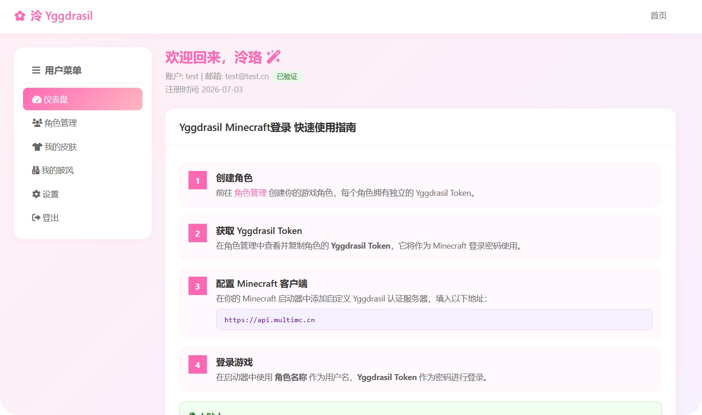
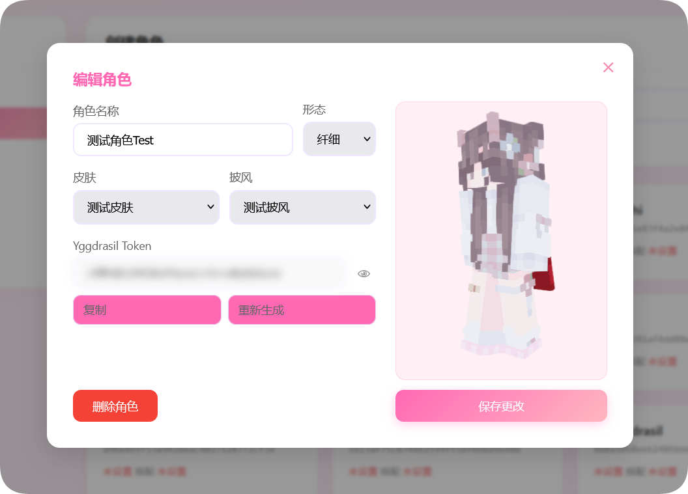

<h1 align="center">泠 Yggdrasil</h1>

<p align="center">
  <em>轻盈、安全、优雅的 Minecraft Yggdrasil 外置鉴权系统</em>
</p>

<p align="center">
  
  
  <a href="https://www.gnu.org/licenses/agpl-3.0">
    
  </a>
</p>

<p align="center">
  <a href="README.md">中文</a> | <a href="README_EN.md">English</a>
</p>

<p align="center">
  
</p>

---

## 简介

**泠 Yggdrasil** 是一个为 Minecraft 打造的 **Yggdrasil 外置鉴权系统**，完整兼容 authlib 体系，提供账户注册、登录、角色管理、皮肤/披风托管与好友分享能力。内置 Web 安装向导与二次元风格管控面板，单 JAR 即可部署。

<p align="center">
  
</p>

---

## 快速开始

### 环境要求

| 项目 | 要求 |
|---|---|
| Java | **Java 25** |
| 内存 | 建议至少 512 MB（生产建议 1–2 GB） |
| 磁盘 | 视纹理数量而定 |
| 数据库 | SQLite（默认，零配置）或 MySQL / MariaDB 8.0+ |

### 三步启动

```bash
# 1. 确认 Java 版本（需要 25+）
java --version

# 2. 下载 LingYggdrasil-2.10.0.jar，放入一个独立空目录

# 3. 启动（当前目录会成为数据目录）
java -Xms512M -Xmx2G -jar LingYggdrasil-2.10.0.jar
```

首次启动进入**安装向导** `http://<服务器地址>:35598`，按提示设置管理员账户、外网 URL 与数据库（SQLite 或 MySQL）。安装完成后重启，程序同时提供三个服务：

| 端口 | 用途 | 访问范围 |
|---|---|---|
| `35565` | 用户端（注册/登录/仪表盘/纹理/好友/个人主页） | 对外公开 |
| `35577` | Yggdrasil API（供 Minecraft 启动器调用） | 对外公开 |
| `35599` | 管理后台 | **必须保持私密** |
| `35598` | 安装向导 | 仅首次安装时开放 |

> **安全提醒**：管理端（35599）与安装端口（35598）不应直接暴露公网；建议通过反向代理限制来源，或仅经内网/SSH 隧道访问。

---

## 功能特性

### 用户端

- **角色管理**：多角色创建/删除/改名/形态切换，独立 UUID 与世界树密钥（可查看/轮换，默认虚化）。
- **纹理管理**：上传、列表、详情、别名、公开/私有、删除；角色可绑定本人上传或好友授权的纹理。
- **公共画廊**：`/world` 浏览公开纹理并点赞。
- **好友与分享**：好友码、申请接受/拒绝、拉黑、收到/发出分享；分享纹理可用于角色。
- **个人主页**：`/userhome/{code}` 公开展示（仅公开记录）；注销用户统一遮罩。
- **3D 预览**：skinview3d 角色预览。
- **设置与日志**：密码/邮箱/昵称、外部登录开关、操作日志、主题/语言。
- **账户注销**：二次校验，保留业务数据并统一遮罩。

### 管理后台

- **仪表盘**：用户/角色/纹理等核心数据。
- **用户管理**：搜索、创建、编辑、封禁、邮箱验证、权限组。
- **角色管理**：全局 CRUD、名称修改、所有权转移。
- **纹理资产名册**：分页/搜索、管理名称/作者、下架、存储孤儿扫描与清理。
- **系统设置**：schema 驱动的分区表单、revision 冲突提示（409）。
- **权限组 / Root / 邮件 / 公告 / 日志 / 插件管理**。

### Yggdrasil 协议

- 认证、刷新、验证、登出；
- 加入（`join`，约 30 秒 ticket）与 `hasJoined`；
- 角色查询/批量查询、材质下载；
- 三种签名模式：Ed448、RSA-SHA512、RSA-SHA1；
- 聚合模式：`/<userURL>/api/yggdrasil` 单入口。

### 插件系统

- **稳定 SPI**：`plugins/spi/*.jar`，实现 `im.xz.cn.plugin.spi.Plugin`，隔离类加载。
- **旧 API 兼容**：`plugins/legacy/*.jar` 通过桥接加载。
- **传统插件**：`plugins/` + `plugin.yml` 模式继续可用。

详见 **[插件系统](docs/05-plugins/management.md)** 与 **[插件开发手册](docs/07-plugin-dev/guide.md)**。

---

## 部署与运维

### 数据库

安装向导可直接选择 MySQL/MariaDB，填写 host/port/database/username/password。数据库连接与邮件配置保存在 `sql.yml`，服务与日志配置在 `config.yml`。切换数据库前请备份数据目录。

### 备份与恢复

- SQLite：停机后复制数据目录（核心为 `data.db`）。
- MySQL：`mysqldump --single-transaction lingyggdrasil > backup.sql`，恢复用 `mysql lingyggdrasil < backup.sql`。
- 升级前必须备份。

### 系统服务（示例）

```ini
[Unit]
Description=LingYggdrasil
After=network-online.target

[Service]
User=lingyggdrasil
WorkingDirectory=/opt/lingyggdrasil
ExecStart=/usr/bin/java -Xms512M -Xmx2G -jar LingYggdrasil-2.10.0.jar
Restart=on-failure
RestartSec=5

[Install]
WantedBy=multi-user.target
```

---

## 客户端接入

以 HMCL / PCL 等支持自定义 Yggdrasil 的启动器为例：

1. 登录方式选择「自定义 Yggdrasil / 外置登录」。
2. 认证服务器地址：
   - `default` / `standalone`：填 API 根地址（如 `https://api.example.com`，直连则填 `http://<IP>:35577`）。
   - `aggregate`：填 `https://<用户域名>/api/yggdrasil`。
3. 用户名填**角色名**，密码填该角色的**世界树密钥**。

协议细节见 [Yggdrasil API](docs/04-yggdrasil/api.md) 与 [API 模式](docs/04-yggdrasil/api-modes.md)。

---

## 技术栈

| 组件 | 技术 / 版本 |
|---|---|
| 语言 | Java 25 |
| Web | Javalin 7.2.4（Jetty 12.1.14） |
| JSON | Jackson 2.22.4 |
| 数据库 | SQLite JDBC 3.53.4.0 / MySQL Connector/J 26.10.0 / PostgreSQL 驱动（方言未启用） |
| 连接池 | HikariCP 7.1.0 |
| 加密 | Bouncy Castle 1.86（Argon2、Ed448、RSA） |
| 邮件 | Eclipse Angus Mail 2.0.5 |
| 日志 | Logback 1.6.5 + SLF4J 2.0.20 |
| YAML | SnakeYAML 2.7 |

---

## 文档

完整文档入口见 **[docs/README.md](docs/README.md)**：

| 板块 | 说明 |
|---|---|
| [① 概述](docs/01-overview/README.md) | 项目简介、快速开始、部署运维、配置参考、常见问题 |
| [② 用户系统](docs/02-user/README.md) | 用户功能、权限、界面自定义 |
| [③ 管理系统](docs/03-admin/README.md) | 管理后台、权限、界面自定义 |
| [④ 世界树系统](docs/04-yggdrasil/README.md) | Yggdrasil 认证、API 模式与接口参考 |
| [⑤ 插件系统](docs/05-plugins/README.md) | 插件安装、查看与启停 |
| [⑥ 安全](docs/06-security/README.md) | 加密、会话隔离、请求防护 |
| [⑦ 插件开发手册](docs/07-plugin-dev/README.md) | 新 SPI 与旧 API 桥接、示例 |

---

## 参与贡献

欢迎提交 Issue 与 Pull Request。

### 国际化

内置简体中文（`zh-CN`）。语言包位于 `core/src/main/resources/i18n/`，用户端/管理端分目录，JSON 支持外部覆盖与深度合并；新增语言请在 `lang.json` 的 `languages` 登记并补齐键值。详见 [界面自定义](docs/02-user/customization.md)。

## 许可协议

本项目采用 [GNU Affero General Public License v3.0](LICENSE) 许可协议。
