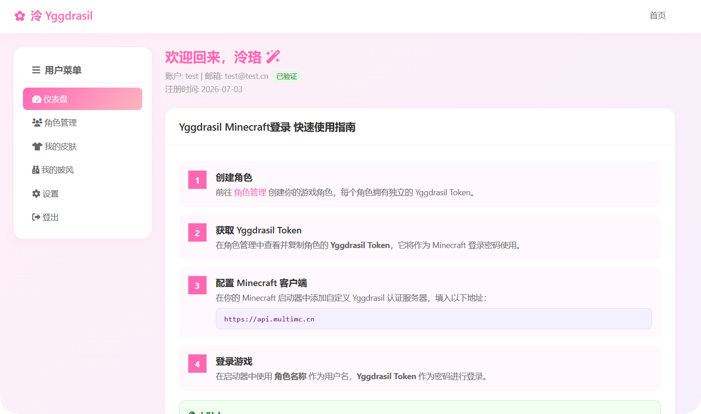
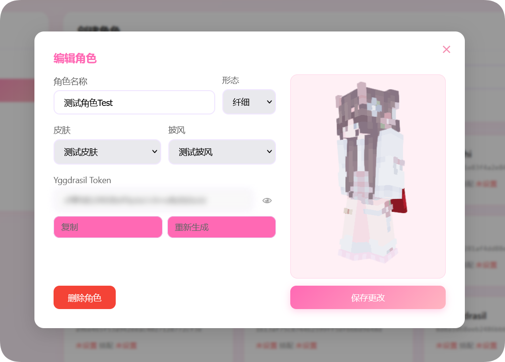

<h1 align="center">LingYggdrasil</h1>

<p align="center">
  <em>A lightweight, secure and elegant Yggdrasil auth system for Minecraft</em>
</p>

<p align="center">
  
  
  <a href="https://www.gnu.org/licenses/agpl-3.0">
    
  </a>
</p>

<p align="center">
  <a href="README.md">中文</a> | <a href="README_EN.md">English</a>
</p>

<p align="center">
  
</p>

---

## Introduction

**LingYggdrasil** is a **Yggdrasil authentication system** for Minecraft. It is fully compatible with the authlib ecosystem and provides account registration, login, profile management, skin/cape hosting, friend sharing and a web-based admin panel — all deployable as a single JAR.

<p align="center">
  
</p>

---

## Quick start

### Requirements

| Item | Requirement |
|---|---|
| Java | **Java 25** |
| Memory | 512 MB minimum (1–2 GB recommended for production) |
| Disk | Depends on texture volume |
| Database | SQLite (default, zero-config) or MySQL / MariaDB 8.0+ |

### Three-step launch

```bash
# 1. Verify Java (25+)
java --version

# 2. Download LingYggdrasil-2.10.1.jar into an empty directory

# 3. Start (current directory becomes the data directory)
java -Xms512M -Xmx2G -jar LingYggdrasil-2.10.1.jar
```

On first launch the **installation wizard** opens at `http://<host>:35598`. After finishing the wizard, restart and the following services are available:

| Port | Purpose | Exposure |
|---|---|---|
| `35565` | User site (register/login/dashboard/textures/friends/user pages) | Public |
| `35577` | Yggdrasil API (for Minecraft launchers) | Public |
| `35599` | Admin panel | **Private only** |
| `35598` | Installation wizard | First-run only |

> **Security**: never expose ports 35599/35598 to the public internet.

---

## Features

### User site

- Multi-profile management (UUID, world-tree key view/rotate, masked by default).
- Texture upload/list/detail/alias/visibility/delete; bind own uploads or friend-shared textures to a profile.
- Public gallery (`/world`) with likes.
- Friends: requests (accept/reject), blocks, sharing; share grants usable for profiles.
- Public user pages (`/userhome/{code}`) with masked cancelled accounts.
- 3D skin preview, account settings, operation logs, themes/languages.
- Account cancellation with one-time validation and consistent masking.

### Admin panel

- Dashboard, user management, profile management and ownership transfer.
- Texture asset registry: paging/search, admin name/author, removal, orphan scan/cleanup.
- Versioned settings editor with revision conflict handling.
- Permission groups, root management, mail, announcements, logs, plugin management.

### Yggdrasil

- Authenticate / refresh / validate / invalidate / signout.
- Join (≈30 s ticket) and `hasJoined`.
- Profile lookup endpoints and texture serving.
- Three signature modes: Ed448, RSA-SHA512, RSA-SHA1.
- Three API modes: `default`, `standalone`, `aggregate`.

### Plugins

- **Stable SPI**: `plugins/spi/*.jar` implementing `im.xz.cn.plugin.spi.Plugin`, isolated classloader.
- **Legacy API**: `plugins/legacy/*.jar` loaded through a compatibility bridge.
- **Traditional plugins**: `plugins/` + `plugin.yml` still supported.

See **[Plugin management](docs/05-plugins/management.md)** and **[Plugin development](docs/07-plugin-dev/guide.md)**.

---

## Deployment

### Database

The installation wizard supports MySQL/MariaDB (host/port/database/username/password). Database and mail settings live in `sql.yml`; service/logging settings live in `config.yml`. Back up the data directory before changing databases.

### Backup & restore

- SQLite: stop the service and copy the data directory (`data.db`).
- MySQL: `mysqldump --single-transaction lingyggdrasil > backup.sql`; restore with `mysql lingyggdrasil < backup.sql`.
- Always back up before upgrading.

### systemd example

```ini
[Unit]
Description=LingYggdrasil
After=network-online.target

[Service]
User=lingyggdrasil
WorkingDirectory=/opt/lingyggdrasil
ExecStart=/usr/bin/java -Xms512M -Xmx2G -jar LingYggdrasil-2.10.1.jar
Restart=on-failure
RestartSec=5

[Install]
WantedBy=multi-user.target
```

---

## Client setup

1. Choose "Custom Yggdrasil / external login" in your launcher.
2. Server URL:
   - `default` / `standalone`: the API root (e.g. `https://api.example.com`, or `http://<IP>:35577` when connecting directly).
   - `aggregate`: `https://<user-domain>/api/yggdrasil`.
3. Username = **profile name**; password = that profile's **world-tree key**.

Details: [Yggdrasil API](docs/04-yggdrasil/api.md) and [API modes](docs/04-yggdrasil/api-modes.md).

---

## Technology

| Component | Technology / version |
|---|---|
| Language | Java 25 |
| Web | Javalin 7.2.4 (Jetty 12.1.14) |
| JSON | Jackson 2.22.4 |
| Database | SQLite JDBC 3.53.4.0 / MySQL Connector/J 26.10.0 / PostgreSQL driver (dialect not enabled) |
| Pool | HikariCP 7.1.0 |
| Crypto | Bouncy Castle 1.86 (Argon2, Ed448, RSA) |
| Mail | Eclipse Angus Mail 2.0.5 |
| Logging | Logback 1.6.5 + SLF4J 2.0.20 |
| YAML | SnakeYAML 2.7 |

---

## Documentation

Entry point: **[docs/README.md](docs/README.md)** (Chinese).

| Section | Description |
|---|---|
| [Overview](docs/01-overview/README.md) | Introduction, getting started, deployment, configuration, FAQ |
| [User](docs/02-user/README.md) | User features, permissions, UI customization |
| [Admin](docs/03-admin/README.md) | Admin panel, permissions, UI customization |
| [Yggdrasil](docs/04-yggdrasil/README.md) | Protocol, API modes, endpoint reference |
| [Plugins](docs/05-plugins/README.md) | Installing and managing plugins |
| [Security](docs/06-security/README.md) | Encryption, session isolation, request protection |
| [Plugin dev](docs/07-plugin-dev/README.md) | SPI and legacy bridge, examples |

---

## Contributing

Issues and pull requests are welcome.

### Internationalization

Simplified Chinese (`zh-CN`) is built in. Language packs live under `core/src/main/resources/i18n/` with separate user/admin JSON files and deep-merge external overrides; register new languages in `lang.json` and fill all keys. See [UI customization](docs/02-user/customization.md).

## License

[GNU Affero General Public License v3.0](LICENSE)
